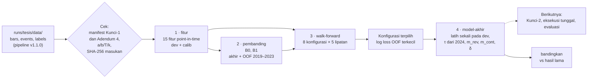

# Pemodelan Gradient Boosting: Fitur, Baseline, Walk-Forward, dan Model Akhir

Dokumen ini menjelaskan empat tahap pemodelan *gradient boosting* (LightGBM) di
`src/model/gradient_boosting/`:

1. rekayasa 15 fitur;
2. baseline non-model B0/B1;
3. validasi *walk-forward* untuk memilih konfigurasi;
4. model akhir, kalibrasi *temperature scaling* τ, dan parameter aturan keputusan.

Rujukan pasal mengikuti *Proposal Final v2*. Rancangan lengkapnya ada di
`Metodologi Pemodelan ML PDH-PDL.md` (di luar repo).

> **Status (27 Nov 2026).** Keempat tahap sudah dijalankan ulang dengan fitur Kunci-1 Adendum 4
> (25 Nov 2026): fitur 14 = CMF-21 bertanda *d* dan fitur 15 = *permutation entropy* 48 *return*
> (Bagian 3). Keluaran di `runs/tesis/model/gradient_boosting/` dan angka di Bagian 9.1 berasal dari
> run ini. Hasil dengan fitur 14–15 lama (*engulfing*, volume relatif; 22–24 Nov 2026) menjadi
> catatan di Bagian 9.2, dan salinan lengkapnya ada di
> `runs/tesis/model/gradient_boosting_fitur_lama_20261124/`. Kunci-2, eksekusi tunggal pada data
> uji, dan evaluasi belum dimulai.

## 1. Kenapa diulang dari awal

Keempat tahap ini sebelumnya dihitung di folder lama `Pemodelan PDH-PDL/` (di luar repo), memakai data
pipeline **sebelum** adendum ATR 2026-11-24. Waktu itu bar sebelum 2015-01-01 dibuang sebelum
indikator dihitung, sehingga:

- `atr14_h1` kosong pada 13 bar pertama 2015;
- `atr14_d`/`atr14_d_prev` kosong pada 13/14 sesi pertama;
- PDH/PDL sesi 2015-01-02 kosong.

Pipeline v1.1.0 memakai riwayat 2009–2014 sebagai pemanasan (lihat
[SPESIFIKASI_DATA.md](SPESIFIKASI_DATA.md) dan `references/README.md`).

| Yang berubah di data masukan | Dampak ke fitur |
|---|---|
| `atr14_h1`: hanya Januari 2015; identik sejak 2015-01-30 | Tidak ada. Fitur ber-ATR H1 (f03, f06, f07, f09–f11) hanya membaca bar ≥ 2016 |
| `atr14_d_prev` event dev 2016 (s.d. 2016-09-23), maks. 4,6 × 10⁻¹⁰ relatif | f02 dan f12 event tersebut bergeser pada orde 10⁻¹⁰ |
| Event, label, data kalibrasi, dan data uji | Tidak berubah |

Dampaknya diperkirakan sangat kecil. Meski begitu, seluruh tahap dihitung ulang dari data v1.1.0 dengan
kode yang kini tersimpan dan teruji di repo. Hasilnya dibandingkan dengan hasil lama lewat perintah
`bandingkan` (Bagian 9), supaya dampaknya bisa ditunjukkan dengan angka, bukan hanya diperkirakan.

Kode ini adalah **port setia** dari kode lama. Rumus fitur, aturan B1, grid LightGBM, *seed*, lipatan,
aturan pemilihan, rentang τ, dan δ sudah dikunci di Kunci-1 (7 dan 17 Nov 2026), jadi tidak
dirancang ulang. Tambahannya hanya pengaman (Bagian 7), struktur folder, dan tes. Satu-satunya
perubahan rumus sesudah itu adalah fitur 14 dan 15, yang diganti lewat Adendum 4 (25 Nov 2026;
Bagian 3).

## 2. Alur



| Tahap | Modul | Data yang dibaca | Keluaran (`runs/tesis/model/gradient_boosting/`) |
|---|---|---|---|
| 1 | `fitur.py`, `laporan_fitur.py` | `bars_devcalib.csv`, `events_{dev,calib}.csv` | `data/features_{dev,calib}.csv`, `output/fitur_rekonsiliasi.json`, `output/laporan_fitur.md` |
| 2 | `pembanding.py` | `features_dev.csv`, `labels_dev.csv` | `data/pembanding_oof_dev.csv`, `output/pembanding_rekonsiliasi.json`, `output/laporan_pembanding.md` |
| 3 | `walk_forward.py` | `features_dev.csv`, `labels_dev.csv`, `pembanding_oof_dev.csv` | `data/walk_forward_oof_dev.csv`, `output/walk_forward_rekonsiliasi.json`, `output/laporan_walk_forward.md` |
| 4 | `model_akhir.py`, `laporan_model_akhir.py` | `features_{dev,calib}.csv`, `labels_{dev,calib}.csv`, `walk_forward_oof_dev.csv`, `walk_forward_rekonsiliasi.json` | `model/model_akhir_lgbm.txt`, `data/model_akhir_calib.csv`, `output/model_akhir_rekonsiliasi.json`, `output/laporan_model_akhir.md`, `output/gambar_reliabilitas_2024.svg` |
| – | `bandingkan.py` | rekonsiliasi baru + `references/gradient_boosting_lama/` | `output/bandingkan_lama.md` |

Folder `runs/tesis/data/` milik pipeline tidak pernah ditulisi. Kode pemodelan hanya menulis ke
`runs/tesis/model/gradient_boosting/`.

## 3. Tahap 1: rekayasa 15 fitur (RM-22, IV.II.5)

Notasi: *t* = *candle* sentuhan, *t*\* = *candle* keputusan (*k* = 0 → *t*\* = *t*), *d* = +1 untuk PDH
dan −1 untuk PDL, ℓ = level PDH/PDL, ATR = ATR(14) H1 pada *t*\*, ATR*d* = ATR(14) harian sesi-sesi
yang sudah selesai (`atr14_d_prev`). Fitur bertanda arah dikalikan *d*, sehingga nilai positif selalu
berarti "menuju atau melewati level".

| No. | Kolom | Rumus | Bar terakhir yang dipakai |
|---|---|---|---|
| 1 | `f01_jenis_level` | 1 bila PDH, 0 bila PDL | – |
| 2 | `f02_rentang_hari_sebelumnya` | (PDH − PDL) / ATR*d* | sesi sebelumnya |
| 3 | `f03_jarak_level_open_sesi` | *d* · (ℓ − O bar pertama sesi) / ATR | *t*\* |
| 4 | `f04_sesi` | Asia 18.00–02.59, London 03.00–07.59, New York 08.00–16.59 (jam NY *t*) | *t* |
| 5 | `f05_hari` | hari `session_date`, Senin–Jumat | – |
| 6 | `f06_rezim_volatilitas` | ATR*t*\* / rata-rata ATR 120 bar s.d. *t*\* | *t*\* |
| 7 | `f07_momentum_pendekatan` | *d* · (C*t*\* − C*t*\*−6) / ATR | *t*\* |
| 8 | `f08_waktu_sejak_open_sesi` | urutan *t* dalam sesi (bar pertama = 1) | *t* |
| 9 | `f09_posisi_close` | *d* · (C*t* − ℓ) / ATR | *t* |
| 10 | `f10_penetrasi` | *d* · (H*t* bila PDH / L*t* bila PDL − ℓ) / ATR | *t* |
| 11 | `f11_jarak_ema50` | *d* · (C*t*\* − EMA50*t*\*) / ATR | *t*\* |
| 12 | `f12_return_minggu` | *d* · (C*t*\* − O bar pertama minggu) / ATR*d* | *t*\* |
| 13 | `f13_wick_penolakan` | wick searah *reversal* / (H*t* − L*t*); 0 bila H = L | *t* |
| 14 | `f14_cmf21_d` | *d* · Σ MFM*i*·V*i* / Σ V*i* atas 21 bar terakhir s.d. *t*\* (termasuk *t*\*). MFM*i* = ((C*i* − L*i*) − (H*i* − C*i*)) / (H*i* − L*i*), 0 bila H*i* = L*i*. V = *tick volume*. 0 bila Σ V = 0. Rentang [−1, 1] | *t*\* |
| 15 | `f15_pe48` | *Permutation entropy* ternormalisasi atas 48 *log return* terakhir s.d. *t*\* (49 *close*), orde 3, tunda 1 (46 pola ordinal): −Σ *p* ln *p* / ln 3!. Nilai yang sama diurutkan menurut kemunculan. Rentang [0, 1]; tidak bertanda *d* | *t*\* |

Fitur 13–15 mengikuti Adendum 4 Kunci-1 (25 Nov 2026; `configs/kunci_1/ADENDUM_4.md` dan
`kunci_1_adendum_4.json`):

- f13 tetap seperti Adendum 1;
- f14 menggantikan `f14_engulfing_d`, dan f15 menggantikan `f15_volume_relatif`;
- dasar pemilihannya literatur, bukan kuesioner. Kuesioner kini hanya menjadi sumber aturan B1.

f14 positif berarti tekanan menuju atau melewati level (beli di PDH, jual di PDL). f15 adalah fitur
keteraturan jalur harga, bukan fitur arah: 0 berarti pola berulang, 1 berarti mendekati acak. "Bar"
adalah bar H1 yang tersedia, berurutan menurut waktu; bar yang hilang tidak ditambal. Bila riwayat
kurang dari 21 bar (f14) atau 49 *close* (f15), fitur kosong. Pada data dev/calib hal ini tidak
diharapkan terjadi, karena 2015 menjadi pemanasan, dan `cek_tanpa_kosong` menghentikan tahap bila
terjadi.

Kolom `b1_terpenuhi` = f13 ≥ θ (θ = 0,6666666667, toleransi 10⁻⁹) disimpan untuk baseline B1.
Aturan B1 tidak diubah Adendum 4.

**Bukti *point-in-time*.**

- **Guard mekanis.** Setiap akses ke bar dan EMA lewat `PointInTime`, yang melempar `LookAheadError`
  bila indeksnya melewati *t*\*. Jendela CMF dan *permutation entropy* juga dibaca lewat guard ini.
- **Uji pemotongan.** Deret bar dipotong tepat pada bar keputusan beberapa event, lalu semua konteks
  (EMA dan peta minggu) dihitung ulang. Fitur harus identik persis dengan perhitungan pada data
  penuh. Bila ada satu saja yang berbeda, tahap berhenti sebelum berkas apa pun ditulis.

Statistik deskriptif ada di `laporan_fitur.md` dan sengaja tidak dikondisikan pada label.

## 4. Tahap 2: baseline B0 dan B1 (RM-23, IV.II.6)

| Baseline | Cara kerja |
|---|---|
| **B0** · peluang dasar | Frekuensi kelas (*Reversal*, *Continuation*, Netral) pada data latih |
| **B1** · heuristik *wick* | Frekuensi kelas pada data latih, dipisah menurut f13 ≥ 2/3. Kelompok yang tidak memiliki salah satu kelas diberi Laplace +1 per kelas |

Keduanya dihitung dua kali:

1. **Akhir:** satu kali pada seluruh dev 2016–2023 (pembanding untuk Kunci-2).
2. **OOF:** ulang pada data latih setiap lipatan *walk-forward* (Bagian 5), sehingga tersedia prediksi
   *out-of-fold* yang sebanding dengan prediksi model.

*Log loss* = −ln *p*(label), dengan peluang dipotong ke [10⁻¹⁵, 1] lalu dinormalkan ulang.
*Purging* membuang event latih yang jendela labelnya (`label_end_session_date`) mencapai batas lipatan.
B2 (regresi logistik) tidak dihitung, sesuai keputusan 22 Nov 2026 (menunggu Adendum 3). Hanya data
dev yang dimuat.

## 5. Tahap 3: validasi walk-forward (RM-24, IV.II.4 dan IV.II.6)

Model selalu dilatih pada masa lalu dan dinilai pada tahun berikutnya (lipatan berjangkar):

| Lipatan | Latih | Validasi |
|---|---|---|
| 1 | 2016–2018 | 2019 |
| 2 | 2016–2019 | 2020 |
| 3 | 2016–2020 | 2021 |
| 4 | 2016–2021 | 2022 |
| 5 | 2016–2022 | 2023 |

| Parameter (Kunci-1) | Nilai |
|---|---|
| `objective`, `learning_rate` | `multiclass` (3 kelas), 0,05 |
| `max_depth` × `n_estimators` × `min_child_samples` | {2, 3} × {100, 300} × {20, 50} = 8 konfigurasi |
| `seed`, `deterministic`, `num_threads` | 20261119, `true`, 1 |
| Pengodean | f04 dan f05 *one-hot* (21 kolom), fitur lain numerik |
| Pemilihan | rata-rata *log loss* OOF terkecil atas seluruh event 2019–2023 |
| Seri (selisih ≤ 10⁻⁶) | pohon lebih sedikit → kedalaman lebih kecil → `min_child_samples` lebih besar |

Grid dan parameter teknis dibaca dari `kunci_1_rq2.json`, lalu dicocokkan lagi dengan nilai terkunci di
kode. Bila berbeda, proses berhenti. Probabilitas *walk-forward* tidak dikalibrasi. Selisih *log loss*
model terpilih − B0/B1 per tahun dilaporkan secara deskriptif, bukan sebagai uji keunggulan.

## 6. Tahap 4: model akhir, kalibrasi τ, dan aturan keputusan (RM-25 s.d. RM-27, IV.II.6–IV.II.8)

Modul `model_akhir.py` (perhitungan) dan `laporan_model_akhir.py` (laporan Markdown dan diagram SVG).

1. **Model akhir (RM-25).** Konfigurasi terpilih *walk-forward* dilatih **sekali** pada seluruh dev
   2016–2023, dengan *purging* di batas 2024-01-01 dan parameter Kunci-1 yang sama dengan tahap 3.
   Model tidak dilatih ulang dengan data 2024, agar τ dari 2024 berlaku persis untuk model yang diuji.
   Model disimpan sebagai teks LightGBM (`model/model_akhir_lgbm.txt`) beserta SHA-256-nya.
2. **Kalibrasi τ (RM-26).** *Temperature scaling*: *p* = softmax(*z* / τ) atas skor mentah LightGBM.
   τ meminimalkan *log loss* data kalibrasi 2024 dan dicari dengan *golden-section* pada rentang
   terkunci [0,05; 20]. Hasilnya dicek terhadap grid log-spasi 401 titik agar bukan minimum lokal.
   *Log loss*, Brier, dan ECE per kelas (10 bin) dilaporkan sebelum dan sesudah τ, bersama B0/B1 pada
   2024 sebagai acuan.
3. **Aturan keputusan (RM-27).** *m*rev dan *m*cont = rata-rata R posisi *reversal* dan
   *continuation* pada event Netral dev. Nilai harapan *E*(rev) = *p*rev · a/b − *p*cont + *p*net ·
   *m*rev dan *E*(cont) = *p*cont · b/a − *p*rev + *p*net · *m*cont. Rekomendasi = aksi dengan *E*
   tertinggi bila ≥ δ = 0,1R; selain itu abstain.

Pratinjau aturan keputusan pada 2024 dan pada OOF *walk-forward* 2019–2023 (R kotor, tanpa biaya)
hanya deskriptif dan tidak dipakai untuk memilih δ atau parameter lain.

| Keluaran | Isi |
|---|---|
| `model/model_akhir_lgbm.txt` | Model LightGBM (teks), SHA-256 dicatat di rekonsiliasi |
| `data/model_akhir_calib.csv` | Per event 2024: skor mentah, peluang sebelum/sesudah τ, *log loss*, *E*, rekomendasi, R |
| `output/model_akhir_rekonsiliasi.json` | Semua angka calon Kunci-2: konfigurasi, τ, *m*rev, *m*cont, δ, B0/B1 dev, kolom fitur, versi pustaka |
| `output/laporan_model_akhir.md`, `output/gambar_reliabilitas_2024.svg` | Laporan dan diagram reliabilitas |

## 7. Sumber parameter dan pengaman

| Pengaman | Isi | Galat bila dilanggar |
|---|---|---|
| Manifest Kunci-1 | `configs/kunci_1/` = salinan byte-identik berkas Kunci-1; SHA-256 dicek terhadap `MANIFEST_KUNCI_1.json` dan `MANIFEST_KUNCI_1_ADENDUM_4.json` (yang juga mencatat hash manifest sebelumnya) | `KunciError` |
| Fitur sesuai kunci (baru) | Nama fitur 13–15, jendela CMF (21), dan parameter *permutation entropy* (48 *return*, orde 3, tunda 1) di kode = `kunci_1_adendum_4.json`; θ B1 di adendum = `kunci_1_fitur.json`. Rumus MFM, aturan nilai seri, dan normalisasi dijaga tes unit, bukan pemeriksaan ini. SHA-256 `kunci_1_fitur.json` dan `kunci_1_adendum_4.json` dicatat di `fitur_rekonsiliasi.json` dan `model_akhir_rekonsiliasi.json` | `KunciError` |
| Label | a/b/T/k `configs/tesis.json` = `kunci_1.json` | `KunciError` |
| Data masukan | SHA-256 `bars_devcalib`, `events_{dev,calib}`, `labels_{dev,calib}` = `references/tesis.json`. Acuan wajib ada, kecuali dengan `--tanpa-acuan` | `DataInputBerbeda` / `FileNotFoundError` |
| Urutan tahap | OOF pembanding harus dihitung dari `features_dev.csv` dan `labels_dev.csv` yang sekarang (hash di `pembanding_rekonsiliasi.json`) | `ValueError` |
| Konfigurasi model akhir | Konfigurasi terpilih harus anggota grid, terpilih ulang dari skor *walk-forward*, dan `features_dev.csv`/`labels_dev.csv` sama dengan saat *walk-forward* | `ValueError` |
| Rentang split | Event dev harus 2016–2023 dan calib 2024 | `ValueError` |
| R label | `R_rev`/`R_cont` sesuai Tabel 4.3 (barrier bernilai tetap, Netral konsisten) | `ValueError` |
| Skor mentah | softmax(skor mentah) = `predict` LightGBM (selisih ≤ 10⁻⁹); τ hasil *golden-section* tidak kalah dari grid 401 titik | `RuntimeError` |
| Acuan lama | SHA-256 berkas `references/gradient_boosting_lama/` = `asal.json` | `AcuanLamaRusak` |
| **Guard ATR (baru)** | Setiap bar wajib punya `atr14_h1` > 0, dan setiap event wajib punya `atr14_d_prev` > 0 | `AtrKosong` |
| Fitur kosong (baru) | Tidak boleh ada fitur dev/calib yang kosong | `ValueError` |
| Data uji | Semua data lewat `load_model_csv`: folder `kunci_uji*` dan `session_date` > 2024-12-31 ditolak | `TestDataLeak` |
| *Point-in-time* | `PointInTime` + uji pemotongan | `LookAheadError` |

Guard ATR membuat data dari pipeline < 1.1.0 (13 bar pertama 2015 tanpa ATR) langsung ditolak, sehingga
kesalahan yang sama tidak bisa terulang tanpa terlihat. Setiap rekonsiliasi mencatat hash masukan,
`versi_pdhl_data`, dan *commit* git untuk audit.

## 8. Menjalankan

Data pipeline harus dibuat lebih dulu dengan kode v1.1.0:

```bash
PYTHONPATH=src python3 -m pdhl_data run --config configs/tesis.json
```

Tahap fitur dan baseline hanya memakai stdlib. Tahap *walk-forward* dan model akhir butuh LightGBM:

```bash
pip install -e '.[model]'
```

Menjalankan semua tahap secara berurutan (fitur → pembanding → walk-forward → model-akhir →
bandingkan):

```bash
PYTHONPATH=src python3 -m model.gradient_boosting semua --config configs/tesis.json
```

Tahap juga bisa dijalankan satu per satu: `fitur`, `pembanding`, `walk-forward`, `model-akhir`, atau
`bandingkan`.

Visualisasi untuk dokumentasi dibuat terpisah (tidak termasuk `semua`) sesudah `model-akhir`:

```bash
pip install -e '.[model,viz]'
```

```bash
PYTHONPATH=src python3 -m model.gradient_boosting gambar --config configs/tesis.json
```

Tahap ini menulis 22 PNG ke `runs/tesis/model/gradient_boosting/gambar/` (Proses 0–6, berawalan
`p0_` s.d. `p6_`). Gambar hanya membaca keluaran tahap sebelumnya lewat `load_model_csv` dan memakai
ulang fungsi `model_akhir` untuk nilai harapan dan pratinjau. Kurva belajar (`p3_4` s.d. `p3_6`)
melatih ulang model lipatan *walk-forward* dengan parameter Kunci-1 yang sama untuk mencatat log
loss dan akurasi per iterasi; log loss validasi pada 100 dan 300 pohon dicek harus sama dengan skor
*walk-forward*. Kurva ini deskriptif dan tidak dipakai untuk memilih jumlah pohon. Palet warna divalidasi dengan skill *dataviz* (tiga slot kategori pertama, aman buta warna).
Tahap berikutnya menolak berjalan bila keluaran tahap sebelumnya belum ada. Opsi lain:

- `--runs-dir` untuk folder run;
- `--reference` untuk acuan hash, dan `--tanpa-acuan` untuk konfigurasi yang belum punya acuan;
- `--kunci-dir` untuk folder Kunci-1;
- `--acuan-lama` untuk hasil lama.

Kode keluar 0 = selesai, 1 = galat (pesannya di stderr). Setelah `pip install -e '.[model]'`,
perintah `pdhl-gb semua --config configs/tesis.json` setara.

Tes (data sintetis; tes LightGBM dilewati bila pustakanya tidak ada):

```bash
python3 -m unittest discover -s tests -v
```

## 9. Hasil dan cara membaca `bandingkan`

### 9.1 Hasil run Adendum 4 (27 Nov 2026)

Pipeline data dijalankan ulang lebih dulu (`19/19 OK`; event, label, dan kunci uji tidak berubah),
lalu `semua` dengan Python 3.10.21, LightGBM 4.7.0, NumPy 2.2.6, dan SciPy 1.15.3. Data uji tidak
dibaca.

**Fitur.** 1.841 event dev dan 227 calib, 15 fitur tanpa nilai kosong. Uji pemotongan pada 4 titik:
0 beda. Rata-rata f14 CMF-21 0,064 (dev) dan 0,083 (calib); f15 PE-48 0,978 dan 0,979. Korelasi
|r| tertinggi f14 dengan fitur lain 0,31 (f11); f15 praktis tidak berkorelasi dengan fitur lain
(|r| ≤ 0,04).

**Baseline B0/B1.** Identik dengan hasil lama (181/181 angka rekonsiliasi), karena tidak bergantung
pada fitur model. OOF gabungan B0 0,9698 dan B1 0,9678.

**Walk-forward (log loss OOF 2019–2023, n = 1.152).**

| Konfigurasi | Log loss | Peringkat | Fitur lama |
|---|---|---|---|
| **d2_n100_m50** | **0,9282** | 1 (terpilih) | 0,9233 |
| d2_n100_m20 | 0,9296 | 2 | 0,9278 |
| d3_n100_m50 | 0,9311 | 3 | 0,9302 |
| d3_n100_m20 | 0,9344 | 4 | 0,9355 |
| d2_n300_m50 | 0,9541 | 5 | 0,9476 |
| d2_n300_m20 | 0,9569 | 6 | 0,9513 |
| d3_n300_m50 | 0,9867 | 7 | 0,9739 |
| d3_n300_m20 | 1,0025 | 8 | 1,0008 |

Hasil gabungan: model − B0 = −0,0416 dan model − B1 = −0,0396; model lebih baik daripada B0 dan B1
di kelima tahun validasi. Konfigurasi terpilih dan urutan peringkat sama dengan fitur lama.

**Model akhir dan kalibrasi (data 2024, n = 227).** d2_n100_m50 dilatih pada 1.841 event dev
(*purging* 0) menjadi 300 pohon; SHA-256 berkas model `ff3815fc53c07a62…`; log loss dalam-sampel
0,8657.

| Prediktor | *Log loss* | Brier |
|---|---|---|
| Model sebelum τ | 0,9351 | 0,5682 |
| **Model sesudah τ = 1,0100** | **0,9351** | **0,5680** |
| B0 | 0,9967 | 0,5948 |
| B1 | 1,0013 | 0,5985 |

**Aturan keputusan.** *m*rev = +0,5627R dan *m*cont = −0,2813R dari 385 event Netral dev (tidak
berubah); δ = 0,1R. Pratinjau SM δ = 0,1 (deskriptif, R kotor): calib 2024 cakupan 37,9%,
+0,1877R per rekomendasi; OOF 2019–2023 cakupan 48,0%, +0,0065R per rekomendasi.

**`bandingkan_lama.md`.**

| Berkas | IDENTIK | BEDA | HANYA_LAMA | HANYA_BARU |
|---|---|---|---|---|
| `fitur_rekonsiliasi.json` | 85 | 0 | 14 | 10 |
| `pembanding_rekonsiliasi.json` | 181 | 0 | 0 | 0 |
| `walk_forward_rekonsiliasi.json` | 128 | 69 | 0 | 0 |
| `model_akhir_rekonsiliasi.json` | 427 | 156 | 0 | 1 |

Tidak ada BEDA_KECIL. Semua angka f01–f13 dan B0/B1 IDENTIK. HANYA_LAMA/HANYA_BARU pada fitur adalah
angka f14/f15 lama dan baru, ditambah hash manifest Kunci-1 yang kini ikut dicatat. BEDA pada
*walk-forward* dan model akhir memang diharapkan dari penggantian fitur.

**Determinisme.** `semua` dijalankan dua kali. `features_{dev,calib}.csv`, kedua berkas OOF,
`model_akhir_calib.csv`, dan berkas model byte-identik antar-run.

### 9.2 Hasil fitur lama (22–24 Nov 2026) sebagai acuan

> Semua angka di subbagian ini dihitung dengan fitur 14–15 lama. Yang tetap sama sesudah
> Adendum 4 hanyalah fitur f01–f13, seluruh baseline B0/B1, serta *m*rev dan *m*cont.

Angka berikut berasal dari `references/gradient_boosting_lama/` (22 Nov 2026, data sebelum adendum
ATR; LightGBM 4.7.0, NumPy 2.2.6, Python 3.10).

**Fitur.** 1.841 event dev dan 227 calib, tanpa nilai kosong. B1 terpenuhi pada 173 event dev dan 23
event calib. Uji pemotongan pada 4 titik: 0 beda.

**Baseline akhir (dev 2016–2023).**

| Baseline | n | *Reversal* | *Continuation* | Netral |
|---|---|---|---|---|
| B0 | 1.841 | 22,5% | 56,6% | 20,9% |
| B1 · *wick* ≥ 2/3 | 173 | 24,3% | 48,0% | 27,7% |
| B1 · *wick* < 2/3 | 1.668 | 22,3% | 57,5% | 20,2% |

**Walk-forward (log loss OOF 2019–2023, n = 1.152).**

| Konfigurasi | Log loss | Peringkat |
|---|---|---|
| **d2_n100_m50** | **0,9233** | 1 (terpilih) |
| d2_n100_m20 | 0,9278 | 2 |
| d3_n100_m50 | 0,9302 | 3 |
| d3_n100_m20 | 0,9355 | 4 |
| d2_n300_m50 | 0,9476 | 5 |
| d2_n300_m20 | 0,9513 | 6 |
| d3_n300_m50 | 0,9739 | 7 |
| d3_n300_m20 | 1,0008 | 8 |

Hasil gabungan: model − B0 = −0,0465 dan model − B1 = −0,0445 (B0 0,9698, B1 0,9678).

**Model akhir dan kalibrasi (data 2024, n = 227).** d2_n100_m50 dilatih pada 1.841 event dev
(*purging* 0) menjadi 300 pohon; SHA-256 berkas model `1c1f7ab4f00bce19…`.

| Prediktor | *Log loss* | Brier |
|---|---|---|
| Model sebelum τ | 0,9356 | 0,5692 |
| **Model sesudah τ = 1,0142** | **0,9355** | **0,5690** |
| B0 | 0,9967 | 0,5948 |
| B1 | 1,0013 | 0,5985 |

**Aturan keputusan.** *m*rev = +0,5627R dan *m*cont = −0,2813R dari 385 event Netral dev;
δ = 0,1R.

**Membaca `bandingkan_lama.md`.** Setiap angka rekonsiliasi diberi status:

| Status | Arti | Yang diharapkan |
|---|---|---|
| IDENTIK | sama persis | hampir semua angka |
| BEDA_KECIL | \|selisih\| ≤ 10⁻⁹ × max(1, \|nilai\|) | mungkin muncul pada jumlah f02/f12 dev (efek ATR harian 2016) |
| BEDA | perlu ditinjau | tidak diharapkan; konfigurasi terpilih seharusnya tetap d2_n100_m50 |

Hash sumber, lingkungan, versi, dan *commit* diabaikan karena memang pasti berbeda. Bila ada status
BEDA, catat di sini angka mana yang berubah dan alasannya sebelum melanjutkan ke model akhir.

**Hasil perhitungan ulang (24 Nov 2026).** Keempat tahap dijalankan ulang dengan data pipeline v1.1.0,
Python 3.10.21, LightGBM 4.7.0, dan NumPy 2.2.6. Tidak ada status BEDA_KECIL maupun BEDA:

| Berkas | IDENTIK | Lainnya |
|---|---|---|
| `fitur_rekonsiliasi.json` | 99 | 0 |
| `pembanding_rekonsiliasi.json` | 181 | 0 |
| `walk_forward_rekonsiliasi.json` | 197 | 0 |
| `model_akhir_rekonsiliasi.json` | 583 | 0 |

Adendum ATR hanya mengubah 43 nilai f02/f12 pada 27 event dev 4 Jan – 9 Mar 2016, dan perubahannya
ada di desimal ke-10 (≤ 10⁻⁹). `features_calib.csv`, kedua berkas OOF, berkas model, dan
`model_akhir_calib.csv` byte-identik dengan hasil lama. Jadi angka 22 Nov 2026 tetap berlaku.

## 10. Yang belum di repo

- Kunci-2: manifest semua ketetapan (model, τ, δ, pembanding, templat SHAP) + *commit hash*.
- Eksekusi tunggal pada data uji dan evaluasi RO1/RO2 + SHAP.

## Asal kode

| Modul baru | Asal (folder lama di luar repo) |
|---|---|
| `fitur.py`, `laporan_fitur.py` | `Pemodelan PDH-PDL/fitur.py`, `laporan_fitur.py`; f14 dan f15 baru (Adendum 4, 27 Nov 2026) |
| `pembanding.py` | `Pemodelan PDH-PDL/pembanding.py` |
| `walk_forward.py` | `Pemodelan PDH-PDL/walk_forward.py` |
| `model_akhir.py`, `laporan_model_akhir.py` | `Pemodelan PDH-PDL/model_akhir.py` |
| `gambar/` | Baru (24 Nov 2026); diagram reliabilitas mengikuti `gambar_reliabilitas` lama |
| `kunci.py` | `Pemodelan PDH-PDL/common.py` (`load_kunci1_fitur`, `load_kunci1_rq2`); pemuat dan manifest Adendum 4 baru |
| `tests/test_gb_*.py` | `Pemodelan PDH-PDL/tests/test_fitur.py`, `test_pembanding.py`, `test_walk_forward.py`, `test_model_akhir.py`, `test_kunci_rq2.py` |
