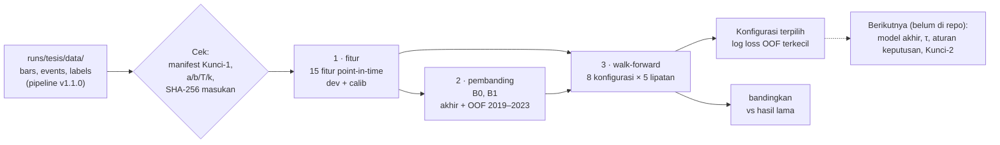

# Pemodelan Gradient Boosting: Fitur, Baseline, dan Validasi Walk-Forward

Dokumen ini menjelaskan tiga tahap pertama pemodelan *gradient boosting* (LightGBM) di
`src/model/gradient_boosting/`:

1. rekayasa 15 fitur;
2. baseline non-model B0/B1;
3. validasi *walk-forward* untuk memilih konfigurasi.

Rujukan pasal mengikuti *Proposal Final v2*. Rancangan lengkapnya ada di
`Metodologi Pemodelan ML PDH-PDL.md` (di luar repo).

> **Status (24 Nov 2026).** Kode dan tes sudah ada, tetapi **belum dijalankan pada data asli**. Hasil
> lama (22 Nov 2026) dicantumkan di Bagian 8 sebagai acuan. Model akhir, kalibrasi τ, aturan keputusan,
> dan Kunci-2 belum dipindahkan ke repo.

## 1. Kenapa diulang dari awal

Ketiga tahap ini sebelumnya dihitung di folder lama `Pemodelan PDH-PDL/` (di luar repo), memakai data
pipeline **sebelum** adendum ATR 2026-11-24. Waktu itu bar sebelum 2015-01-01 dibuang sebelum
indikator dihitung, sehingga:

- `atr14_h1` kosong pada 13 bar pertama 2015;
- `atr14_d`/`atr14_d_prev` kosong pada 13/14 sesi pertama;
- PDH/PDL sesi 2015-01-02 kosong.

Pipeline v1.1.0 memakai riwayat 2009–2014 sebagai pemanasan (lihat
[SPESIFIKASI_DATA.md](SPESIFIKASI_DATA.md) dan `references/README.md`).

| Yang berubah di data masukan | Dampak ke fitur |
|---|---|
| `atr14_h1`: hanya Januari 2015; identik sejak 2015-01-30 | Tidak ada. Fitur ber-ATR H1 (f03, f06, f07, f09–f11) hanya membaca bar ≥ 2016 |
| `atr14_d_prev` event dev 2016 (s.d. 2016-09-23), maks. 4,6 × 10⁻¹⁰ relatif | f02 dan f12 event tersebut bergeser pada orde 10⁻¹⁰ |
| Event, label, data kalibrasi, dan data uji | Tidak berubah |

Dampaknya diperkirakan sangat kecil. Meski begitu, seluruh tahap dihitung ulang dari data v1.1.0 dengan
kode yang kini tersimpan dan teruji di repo. Hasilnya dibandingkan dengan hasil lama lewat perintah
`bandingkan` (Bagian 8), supaya dampaknya bisa ditunjukkan dengan angka, bukan hanya diperkirakan.

Kode ini adalah **port setia** dari kode lama. Rumus fitur, aturan B1, grid LightGBM, *seed*, lipatan,
dan aturan pemilihan sudah dikunci di Kunci-1 (7 dan 17 Nov 2026), jadi tidak dirancang ulang.
Tambahannya hanya pengaman (Bagian 6), struktur folder, dan tes.

## 2. Alur



| Tahap | Modul | Data yang dibaca | Keluaran (`runs/tesis/model/gradient_boosting/`) |
|---|---|---|---|
| 1 | `fitur.py`, `laporan_fitur.py` | `bars_devcalib.csv`, `events_{dev,calib}.csv` | `data/features_{dev,calib}.csv`, `output/fitur_rekonsiliasi.json`, `output/laporan_fitur.md` |
| 2 | `pembanding.py` | `features_dev.csv`, `labels_dev.csv` | `data/pembanding_oof_dev.csv`, `output/pembanding_rekonsiliasi.json`, `output/laporan_pembanding.md` |
| 3 | `walk_forward.py` | `features_dev.csv`, `labels_dev.csv`, `pembanding_oof_dev.csv` | `data/walk_forward_oof_dev.csv`, `output/walk_forward_rekonsiliasi.json`, `output/laporan_walk_forward.md` |
| – | `bandingkan.py` | rekonsiliasi baru + `references/gradient_boosting_lama/` | `output/bandingkan_lama.md` |

Folder `runs/tesis/data/` milik pipeline tidak pernah ditulisi. Kode pemodelan hanya menulis ke
`runs/tesis/model/gradient_boosting/`.

## 3. Tahap 1: rekayasa 15 fitur (RM-22, IV.II.5)

Notasi: *t* = *candle* sentuhan, *t*\* = *candle* keputusan (*k* = 0 → *t*\* = *t*), *d* = +1 untuk PDH
dan −1 untuk PDL, ℓ = level PDH/PDL, ATR = ATR(14) H1 pada *t*\*, ATR*d* = ATR(14) harian sesi-sesi
yang sudah selesai (`atr14_d_prev`). Fitur bertanda arah dikalikan *d*, sehingga nilai positif selalu
berarti "menuju atau melewati level".

| No. | Kolom | Rumus | Bar terakhir yang dipakai |
|---|---|---|---|
| 1 | `f01_jenis_level` | 1 bila PDH, 0 bila PDL | – |
| 2 | `f02_rentang_hari_sebelumnya` | (PDH − PDL) / ATR*d* | sesi sebelumnya |
| 3 | `f03_jarak_level_open_sesi` | *d* · (ℓ − O bar pertama sesi) / ATR | *t*\* |
| 4 | `f04_sesi` | Asia 18.00–02.59, London 03.00–07.59, New York 08.00–16.59 (jam NY *t*) | *t* |
| 5 | `f05_hari` | hari `session_date`, Senin–Jumat | – |
| 6 | `f06_rezim_volatilitas` | ATR*t*\* / rata-rata ATR 120 bar s.d. *t*\* | *t*\* |
| 7 | `f07_momentum_pendekatan` | *d* · (C*t*\* − C*t*\*−6) / ATR | *t*\* |
| 8 | `f08_waktu_sejak_open_sesi` | urutan *t* dalam sesi (bar pertama = 1) | *t* |
| 9 | `f09_posisi_close` | *d* · (C*t* − ℓ) / ATR | *t* |
| 10 | `f10_penetrasi` | *d* · (H*t* bila PDH / L*t* bila PDL − ℓ) / ATR | *t* |
| 11 | `f11_jarak_ema50` | *d* · (C*t*\* − EMA50*t*\*) / ATR | *t*\* |
| 12 | `f12_return_minggu` | *d* · (C*t*\* − O bar pertama minggu) / ATR*d* | *t*\* |
| 13 | `f13_wick_penolakan` | wick searah *reversal* / (H*t* − L*t*); 0 bila H = L | *t* |
| 14 | `f14_engulfing_d` | *d* · arah badan *t* bila *t* engulfing *t* − 1, selain itu 0 | *t* |
| 15 | `f15_volume_relatif` | V*t* / rata-rata V jam NY yang sama pada 20 sesi sebelumnya (min. 10 bar) | *t* |

Fitur 13–15 berasal dari Adendum 1 Kunci-1 (isyarat yang paling sering disebut responden: *wick* 5,
*engulfing* 3, volume 3 dari 9 responden). Kolom `b1_terpenuhi` = f13 ≥ θ (θ = 0,6666666667,
toleransi 10⁻⁹) disimpan untuk baseline B1.

**Bukti *point-in-time*.**

- **Guard mekanis.** Setiap akses ke bar dan EMA lewat `PointInTime`, yang melempar `LookAheadError`
  bila indeksnya melewati *t*\*.
- **Uji pemotongan.** Deret bar dipotong tepat pada bar keputusan beberapa event, lalu semua konteks
  (EMA, peta minggu, peta sesi × jam) dihitung ulang. Fitur harus identik persis dengan perhitungan
  pada data penuh. Bila ada satu saja yang berbeda, tahap berhenti sebelum berkas apa pun ditulis.

Statistik deskriptif ada di `laporan_fitur.md` dan sengaja tidak dikondisikan pada label.

## 4. Tahap 2: baseline B0 dan B1 (RM-23, IV.II.6)

| Baseline | Cara kerja |
|---|---|
| **B0** · peluang dasar | Frekuensi kelas (*Reversal*, *Continuation*, Netral) pada data latih |
| **B1** · heuristik *wick* | Frekuensi kelas pada data latih, dipisah menurut f13 ≥ 2/3. Kelompok yang tidak memiliki salah satu kelas diberi Laplace +1 per kelas |

Keduanya dihitung dua kali:

1. **Akhir:** satu kali pada seluruh dev 2016–2023 (pembanding untuk Kunci-2).
2. **OOF:** ulang pada data latih setiap lipatan *walk-forward* (Bagian 5), sehingga tersedia prediksi
   *out-of-fold* yang sebanding dengan prediksi model.

*Log loss* = −ln *p*(label), dengan peluang dipotong ke [10⁻¹⁵, 1] lalu dinormalkan ulang.
*Purging* membuang event latih yang jendela labelnya (`label_end_session_date`) mencapai batas lipatan.
B2 (regresi logistik) tidak dihitung, sesuai keputusan 22 Nov 2026 (menunggu Adendum 3). Hanya data
dev yang dimuat.

## 5. Tahap 3: validasi walk-forward (RM-24, IV.II.4 dan IV.II.6)

Model selalu dilatih pada masa lalu dan dinilai pada tahun berikutnya (lipatan berjangkar):

| Lipatan | Latih | Validasi |
|---|---|---|
| 1 | 2016–2018 | 2019 |
| 2 | 2016–2019 | 2020 |
| 3 | 2016–2020 | 2021 |
| 4 | 2016–2021 | 2022 |
| 5 | 2016–2022 | 2023 |

| Parameter (Kunci-1) | Nilai |
|---|---|
| `objective`, `learning_rate` | `multiclass` (3 kelas), 0,05 |
| `max_depth` × `n_estimators` × `min_child_samples` | {2, 3} × {100, 300} × {20, 50} = 8 konfigurasi |
| `seed`, `deterministic`, `num_threads` | 20261119, `true`, 1 |
| Pengodean | f04 dan f05 *one-hot* (21 kolom), fitur lain numerik |
| Pemilihan | rata-rata *log loss* OOF terkecil atas seluruh event 2019–2023 |
| Seri (selisih ≤ 10⁻⁶) | pohon lebih sedikit → kedalaman lebih kecil → `min_child_samples` lebih besar |

Grid dan parameter teknis dibaca dari `kunci_1_rq2.json`, lalu dicocokkan lagi dengan nilai terkunci di
kode. Bila berbeda, proses berhenti. Probabilitas *walk-forward* tidak dikalibrasi. Selisih *log loss*
model terpilih − B0/B1 per tahun dilaporkan secara deskriptif, bukan sebagai uji keunggulan.

## 6. Sumber parameter dan pengaman

| Pengaman | Isi | Galat bila dilanggar |
|---|---|---|
| Manifest Kunci-1 | `configs/kunci_1/` = salinan byte-identik berkas Kunci-1; SHA-256 dicek terhadap `MANIFEST_KUNCI_1.json` | `KunciError` |
| Label | a/b/T/k `configs/tesis.json` = `kunci_1.json` | `KunciError` |
| Data masukan | SHA-256 `bars_devcalib`, `events_{dev,calib}`, `labels_{dev,calib}` = `references/tesis.json`. Acuan wajib ada, kecuali dengan `--tanpa-acuan` | `DataInputBerbeda` / `FileNotFoundError` |
| Urutan tahap | OOF pembanding harus dihitung dari `features_dev.csv` dan `labels_dev.csv` yang sekarang (hash di `pembanding_rekonsiliasi.json`) | `ValueError` |
| Acuan lama | SHA-256 berkas `references/gradient_boosting_lama/` = `asal.json` | `AcuanLamaRusak` |
| **Guard ATR (baru)** | Setiap bar wajib punya `atr14_h1` > 0, dan setiap event wajib punya `atr14_d_prev` > 0 | `AtrKosong` |
| Fitur kosong (baru) | Tidak boleh ada fitur dev/calib yang kosong | `ValueError` |
| Data uji | Semua data lewat `load_model_csv`: folder `kunci_uji*` dan `session_date` > 2024-12-31 ditolak | `TestDataLeak` |
| *Point-in-time* | `PointInTime` + uji pemotongan | `LookAheadError` |

Guard ATR membuat data dari pipeline < 1.1.0 (13 bar pertama 2015 tanpa ATR) langsung ditolak, sehingga
kesalahan yang sama tidak bisa terulang tanpa terlihat. Setiap rekonsiliasi mencatat hash masukan,
`versi_pdhl_data`, dan *commit* git untuk audit.

## 7. Menjalankan

Data pipeline harus dibuat lebih dulu dengan kode v1.1.0:

```bash
PYTHONPATH=src python3 -m pdhl_data run --config configs/tesis.json
```

Tahap fitur dan baseline hanya memakai stdlib. Tahap *walk-forward* butuh LightGBM:

```bash
pip install -e '.[model]'
```

Menjalankan semua tahap secara berurutan (fitur → pembanding → walk-forward → bandingkan):

```bash
PYTHONPATH=src python3 -m model.gradient_boosting semua --config configs/tesis.json
```

Tahap juga bisa dijalankan satu per satu: `fitur`, `pembanding`, `walk-forward`, atau `bandingkan`.
Tahap berikutnya menolak berjalan bila keluaran tahap sebelumnya belum ada. Opsi lain:

- `--runs-dir` untuk folder run;
- `--reference` untuk acuan hash, dan `--tanpa-acuan` untuk konfigurasi yang belum punya acuan;
- `--kunci-dir` untuk folder Kunci-1;
- `--acuan-lama` untuk hasil lama.

Kode keluar 0 = selesai, 1 = galat (pesannya di stderr). Setelah `pip install -e '.[model]'`,
perintah `pdhl-gb semua --config configs/tesis.json` setara.

Tes (data sintetis; tes LightGBM dilewati bila pustakanya tidak ada):

```bash
python3 -m unittest discover -s tests -v
```

## 8. Hasil lama sebagai acuan dan cara membaca `bandingkan`

Angka berikut berasal dari `references/gradient_boosting_lama/` (22 Nov 2026, data sebelum adendum
ATR; LightGBM 4.7.0, NumPy 2.2.6, Python 3.10).

**Fitur.** 1.841 event dev dan 227 calib, tanpa nilai kosong. B1 terpenuhi pada 173 event dev dan 23
event calib. Uji pemotongan pada 4 titik: 0 beda.

**Baseline akhir (dev 2016–2023).**

| Baseline | n | *Reversal* | *Continuation* | Netral |
|---|---|---|---|---|
| B0 | 1.841 | 22,5% | 56,6% | 20,9% |
| B1 · *wick* ≥ 2/3 | 173 | 24,3% | 48,0% | 27,7% |
| B1 · *wick* < 2/3 | 1.668 | 22,3% | 57,5% | 20,2% |

**Walk-forward (log loss OOF 2019–2023, n = 1.152).**

| Konfigurasi | Log loss | Peringkat |
|---|---|---|
| **d2_n100_m50** | **0,9233** | 1 (terpilih) |
| d2_n100_m20 | 0,9278 | 2 |
| d3_n100_m50 | 0,9302 | 3 |
| d3_n100_m20 | 0,9355 | 4 |
| d2_n300_m50 | 0,9476 | 5 |
| d2_n300_m20 | 0,9513 | 6 |
| d3_n300_m50 | 0,9739 | 7 |
| d3_n300_m20 | 1,0008 | 8 |

Hasil gabungan: model − B0 = −0,0465 dan model − B1 = −0,0445 (B0 0,9698, B1 0,9678).

**Membaca `bandingkan_lama.md`.** Setiap angka rekonsiliasi diberi status:

| Status | Arti | Yang diharapkan |
|---|---|---|
| IDENTIK | sama persis | hampir semua angka |
| BEDA_KECIL | \|selisih\| ≤ 10⁻⁹ × max(1, \|nilai\|) | mungkin muncul pada jumlah f02/f12 dev (efek ATR harian 2016) |
| BEDA | perlu ditinjau | tidak diharapkan; konfigurasi terpilih seharusnya tetap d2_n100_m50 |

Hash sumber, lingkungan, versi, dan *commit* diabaikan karena memang pasti berbeda. Bila ada status
BEDA, catat di sini angka mana yang berubah dan alasannya sebelum melanjutkan ke model akhir.

**Hasil perhitungan ulang:** *(diisi sesudah dijalankan)*.

## 9. Yang belum di repo

- Model akhir (RM-25): konfigurasi terpilih dilatih sekali pada seluruh dev.
- Kalibrasi *temperature scaling* τ pada data 2024 (RM-26).
- Parameter aturan keputusan *m*rev, *m*cont, dan δ = 0,1R (RM-27).
- Kunci-2, eksekusi tunggal pada data uji, dan evaluasi RO1/RO2 + SHAP.

## Asal kode

| Modul baru | Asal (folder lama di luar repo) |
|---|---|
| `fitur.py`, `laporan_fitur.py` | `Pemodelan PDH-PDL/fitur.py`, `laporan_fitur.py` |
| `pembanding.py` | `Pemodelan PDH-PDL/pembanding.py` |
| `walk_forward.py` | `Pemodelan PDH-PDL/walk_forward.py` |
| `kunci.py` | `Pemodelan PDH-PDL/common.py` (`load_kunci1_fitur`, `load_kunci1_rq2`) |
| `tests/test_gb_*.py` | `Pemodelan PDH-PDL/tests/test_fitur.py`, `test_pembanding.py`, `test_walk_forward.py`, `test_kunci_rq2.py` |
