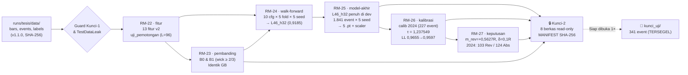

# Pemodelan LSTM: RM-22 (13 Fitur v2) hingga 🔒 Kunci-2 (Pembekuan Pra-Uji)

Dokumen ini menjelaskan seluruh rangkaian pemodelan **LSTM (*Long Short-Term Memory*)** di `src/model/lstm/`, yang dirancang sejajar (*apple-to-apple*) dengan pemodelan Gradient Boosting (`src/model/gradient_boosting/`):

1. **Tahap 1 (`fitur` · RM-22 v2):** rekayasa **13 fitur sekuensial *point-in-time*** per candle (diturunkan dari Proposal Tabel 4.5, Kuesioner RQ1, dan *selected-papers*) + `uji_pemotongan`;
2. **Tahap 2 (`pembanding` · RM-23):** baseline non-model B0 dan B1 (*wick* ≥ 2/3) — **identik bit demi bit dengan Gradient Boosting**;
3. **Tahap 3 (`walk-forward` · RM-24):** validasi *walk-forward* 10 konfigurasi LSTM (5 seed Kunci-1) untuk memilih konfigurasi terbaik berdasarkan rata-rata *log loss* OOF 2019–2023;
4. **Tahap 4 (`model-akhir` · RM-25):** melatih pemenang `L46_h32` penuh 1× pada seluruh `dev` 2016–2023 (`1.841` event × 5 seed) dan menyimpan 5 checkpoint `.pt` + `scaler_L46_h32.json`;
5. **Tahap 5 (`kalibrasi` · RM-26):** mencari 1 skalar suhu `τ` (*Temperature Scaling*, *golden-section search* `[0,05; 20,0]`) pada `calib` 2024 (`227` event) tanpa melatih ulang model;
6. **Tahap 6 (`keputusan` · RM-27):** mengestimasi `m_rev` & `m_cont` dari event Netral `dev` (`385` event) dan menerapkan aturan keputusan `E_rev` / `E_cont` (`δ = 0,1R`) beserta pencatatan `realized_R`;
7. **Tahap 7 (`kunci-2` & `verifikasi-kunci-2` · 🔒 Kunci-2):** membekukan seluruh komponen (`5 × .pt + scaler + τ + m_rev + m_cont + δ = 0,1R + B0/B1 + 13 skrip`) secara *read-only* dan menyegel `MANIFEST_KUNCI_2_LSTM.json` (SHA-256) sebelum menyentuh data uji.

> **Status (25 Nov 2026).** Seluruh tahapan **RM-22 s.d. 🔒 Kunci-2 LSTM** beserta unit test (`26/26` tes LSTM OK, `259` tes lulus pada `.venv`, `pdhl_data verify 19/19 OK`) sudah selesai dan tersegel di `runs/tesis/model/lstm/kunci_2/`. Folder data uji **`runs/tesis/kunci_uji/` (341 event Jan 2025 – Jul 2026) masih tertutup & belum disentuh sama sekali.**
>
> Untuk penjelasan ramah pemula yang dilengkapi simulator interaktif dan grafik SVG, buka [`docs/lstm/panduan_lstm_pemula.html`](panduan_lstm_pemula.html).

---

## 1. Alur Lengkap RM-22 s.d. 🔒 Kunci-2



| Tahap | Modul | Masukan Utama | Keluaran (`runs/tesis/model/lstm/`) |
| :--- | :--- | :--- | :--- |
| RM-22 (`fitur`) | `fitur.py`, `laporan_fitur.py` | `bars_devcalib.csv`, `events_{dev,calib}.csv` | `data/seq_meta_{dev,calib}.csv`, `output/fitur_rekonsiliasi.json`, `output/laporan_fitur.md` |
| RM-23 (`pembanding`) | `pembanding.py` | `seq_meta_dev.csv`, `labels_dev.csv` | `data/pembanding_oof_dev.csv`, `output/pembanding_rekonsiliasi.json`, `output/laporan_pembanding.md` |
| RM-24 (`walk-forward`) | `walk_forward.py`, `arsitektur.py` | `bars_devcalib.csv`, `events_dev.csv`, `labels_dev.csv`, `pembanding_oof_dev.csv` | `data/walk_forward_oof_dev.csv`, `output/walk_forward_rekonsiliasi.json`, `output/laporan_walk_forward.md` |
| RM-25 (`model-akhir`) | `model_akhir.py`, `arsitektur.py` | `walk_forward_rekonsiliasi.json`, data `dev` saja | `checkpoints/lstm_L46_h32_seed*.pt` (5×), `checkpoints/scaler_L46_h32.json`, `output/model_akhir_rekonsiliasi.json`, `output/laporan_model_akhir.md` |
| RM-26 (`kalibrasi`) | `kalibrasi.py` | artefak RM-25, data `calib` 2024, B0/B1 akhir | `data/calib_pred_lstm.csv`, `output/kalibrasi_rekonsiliasi.json`, `output/laporan_kalibrasi.md` |
| RM-27 (`keputusan`) | `keputusan.py` | `calib_pred_lstm.csv`, `labels_{dev,calib}.csv`, B0/B1 akhir | `data/keputusan_calib_lstm.csv`, `output/keputusan_rekonsiliasi.json`, `output/laporan_keputusan.md` |
| 🔒 Kunci-2 (`kunci-2`) | `kunci_2.py` | seluruh rekonsiliasi RM-22..RM-27, 5 `.pt`, scaler, 13 skrip | `kunci_2/` (8 berkas `0o444` + `MANIFEST_KUNCI_2_LSTM.json`) |

---

## 2. Ringkasan 13 Fitur Sekuensial v2 (RM-22) & Baseline (RM-23)

- **13 fitur per candle (`FEATURE_NAMES`):** `dist_level_dir`, `body_dir`, `range_atr`, `wick_against_dir`, `wick_with_dir`, `dist_ema50_dir`, `vol_regime`, `log_vol_rel_hour`, `ny_hour_sin`, `ny_hour_cos`, `weekday_sin`, `weekday_cos`, `log_gap_h`.
- **Anti-kebocoran:** `PointInTime` guard + `uji_pemotongan` (`L = 96`) di 4 titik waktu → **0 mismatch** (`498`, `1.019`, `1.812`, `2.068` event).
- **Baseline RM-23 (`n = 1.152` OOF 2019–2023):** `B0 = 0,9698`, `B1 (wick ≥ 2/3) = 0,9678` (`pembanding_oof_dev.csv` SHA-256 `295010275517ebb1…`, identik bit demi bit dengan Gradient Boosting).

---

## 3. Hasil Walk-Forward RM-24 (10 Konfigurasi, OOF 2019–2023, `n = 1.152`)

| Rank | Konfigurasi | `L` | `hidden` | 2019 | 2020 | 2021 | 2022 | 2023 | **OOF Log-Loss** | Brier | ECE | Avg Epoch |
| :---: | :--- | :---: | :---: | :---: | :---: | :---: | :---: | :---: | :---: | :---: | :---: | :---: |
| **1** | **`L46_h32`** | **46** | **32** | 0,9153 | 0,9702 | **0,9081** | **0,9017** | **0,8980** | **0,9185** | **0,5508** | 0,0370 | 14,6 |
| 2 | `L40_h32` | 40 | 32 | 0,9153 | 0,9701 | 0,9081 | 0,9016 | 0,8987 | 0,9186 | 0,5509 | 0,0373 | 14,5 |
| 3 | `L60_h32` | 60 | 32 | 0,9167 | 0,9704 | 0,9082 | 0,9018 | 0,8985 | 0,9189 | 0,5511 | 0,0327 | 15,4 |
| 4 | `L96_h32` | 96 | 32 | 0,9170 | 0,9703 | 0,9114 | 0,9020 | 0,8970 | 0,9194 | 0,5513 | 0,0313 | 15,8 |
| 5 | `L23_h32` | 23 | 32 | 0,9156 | 0,9698 | 0,9091 | 0,9050 | 0,9034 | 0,9204 | 0,5519 | 0,0306 | 13,3 |
| 6–10 | `h = 16` (5 cfg) | 23..96 | 16 | — | — | — | — | — | 0,9213–0,9230 | 0,5519–0,5531 | 0,0318–0,0363 | 23,3–25,2 |

- **Pemenang terpilih:** **`L46_h32`** (`2 × 23 bar` = tepat 2 sesi perdagangan XAUUSD), unggul `−0,0513` vs B0 (`0,9698`), `−0,0493` vs B1 (`0,9678`), dan mengungguli acuan LightGBM (`0,9233`) pada gabungan maupun 3 tahun terakhir berturut-turut (2021–2023).

---

## 4. Tahap 4: Model Akhir RM-25 (`L46_h32` pada Seluruh `dev` 2016–2023)

- **Data latih:** seluruh `dev` (`2016-01-04` s.d. `2023-12-29`), **`1.841` event** lolos *purging* batas `2024-01-01` (`0` di-purge). Data `calib` 2024 dan `kunci_uji` tidak dimuat.
- **Split internal kronologis 85% / 15%:** `1.565` event awal (`2016-01-04..2022-10-13`) untuk pembaruan bobot `AdamW` dan `fit` `SequenceScaler3D`; `276` event ujung (`2022-10-13..2023-12-29`) untuk *early stopping* (`patience = 12`, `max_epochs = 80`).
- **Uji *round-trip* reload disk (32 event):** selisih maksimum logits in-memory vs muat ulang = **`0,00e+00`**.

| Seed | Best Epoch | Best ES Log-Loss | Berkas Checkpoint (`checkpoints/`) | Ukuran | SHA-256 (16 hex) |
| :---: | :---: | :---: | :--- | :---: | :--- |
| `20261119` | 25 | 0,9074 | `lstm_L46_h32_seed20261119.pt` | 27.629 B | `5e27478581f5dfc9…` |
| `20261120` | 17 | 0,9040 | `lstm_L46_h32_seed20261120.pt` | 27.629 B | `d1eb171cd2119ad6…` |
| `20261121` | 19 | 0,9040 | `lstm_L46_h32_seed20261121.pt` | 27.629 B | `4b9706ec90fc233d…` |
| `20261122` | 29 | 0,8840 | `lstm_L46_h32_seed20261122.pt` | 27.629 B | `de0163d458af6040…` |
| `20261123` | 34 | 0,8880 | `lstm_L46_h32_seed20261123.pt` | 27.629 B | `9dedac45356408e4…` |
| **Rata-rata** | **24,8** | **0,8975** | `scaler_L46_h32.json` (bersama, skip `[8..11]`) | 967 B | `977e6b03528135a8…` |

---

## 5. Tahap 5: Kalibrasi Temperature Scaling `τ` RM-26 (`calib` 2024, `n = 227`)

- **Prosedur:** 5 checkpoint `.pt` + scaler dimuat dalam mode `eval()` tanpa melatih ulang bobot. Rata-rata *logits* 5 seed pada 227 event 2024 dioptimasi memakai ***golden-section search*** pada rentang Kunci-1 `[0,05; 20,0]` (`tol = 1e-10`, `56` iterasi).
- **Hasil suhu optimal:** **`τ* = 1,237549`** (`τ > 1` mendinginkan prediksi *overconfident* tanpa mengubah urutan kelas).

| Model / Tahap (`calib` 2024, `n = 227`) | Log-Loss | Brier | ECE (Top) | ECE Rev | ECE Cont | ECE Net | LL PDH (`129`) | LL PDL (`98`) |
| :--- | :---: | :---: | :---: | :---: | :---: | :---: | :---: | :---: |
| LSTM Raw (`τ = 1,0000`) | 0,9655 | 0,5849 | 0,1013 | 0,0407 | 0,1041 | 0,0446 | 0,9313 | 1,0106 |
| **LSTM Calibrated (`τ = 1,2375`)** | **0,9597** | **0,5812** | **0,0676** | **0,0228** | **0,0621** | 0,0511 | **0,9305** | **0,9981** |
| B0 akhir (`dev`, tanpa τ) | 0,9967 | 0,5948 | 0,0153 | 0,0482 | 0,0153 | 0,0329 | 0,9608 | 1,0440 |
| B1 akhir (`dev`, tanpa τ) | 1,0013 | 0,5985 | 0,0496 | 0,0481 | 0,0496 | 0,0335 | 0,9616 | 1,0536 |

- Kalibrasi menurunkan Log-Loss `−0,0058` dan menekan ECE top-confidence sebesar **33%** (`0,1013 → 0,0676`). Pada data 2024, LSTM terkalibrasi unggul `−0,0370` vs B0 dan `−0,0416` vs B1.

---

## 6. Tahap 6: Aturan Keputusan RM-27 (`m_rev`, `δ = 0,1R`, `realized_R`)

- **Parameter terkunci dari `dev` (`385` Netral, `0` purge) & Kunci-1 (`a = 2, b = 1`):**
  - `m_rev = +0,562671R`, `m_cont = −0,281336R` (`= −0,5 × m_rev`).
  - `E_rev = (+2)·p_rev + (−1)·p_cont + m_rev·p_net` dan `E_cont = −0,5·E_rev`.
  - Ambang utama `δ = 0,1R`: `E_rev ≥ +0,1R` → **Reversal**, `E_rev ≤ −0,2R` (`E_cont ≥ +0,1R`) → **Continuation**, di antaranya → **Abstain (`0R`)**.

| Model (`calib` 2024, `δ = 0,1R`, Pra-Uji) | Rev / Cont / Abs | Cakupan | Total `realized_R` | Mean R / Event | Mean R / Rekomendasi |
| :--- | :---: | :---: | :---: | :---: | :---: |
| **LSTM Calibrated (`τ = 1,2375`)** | **103 / 0 / 124** | **45,4%** | **+1,9126R** | **+0,0084R** | **+0,0186R** |
| LSTM Raw (`τ = 1,0000`) | 57 / 18 / 152 | 33,0% | +2,0047R | +0,0088R | +0,0267R |
| B0 akhir (`dev`) | 0 / 0 / 227 | 0,0% | 0,0000R | 0,0000R | – |
| B1 akhir (`dev`) | 23 / 0 / 204 | 10,1% | −5,3888R | −0,0237R | −0,2343R |

- Kurva cakupan–kinerja `delta_grid` (`calib` 2024, LSTM terkalibrasi): `δ = 0,0R` → `100,0%` (`+23,7584R`), `δ = 0,1R` → `45,4%` (`+1,9126R`), `δ = 0,2R` → `20,3%` (`+2,6705R`), `δ = 0,3R` → `7,0%` (`−0,1342R`). *(Bersifat diagnostik pra-uji, tidak dipakai menyetel `δ`.)*

---

## 7. Tahap 7: 🔒 Kunci-2 — Pembekuan Penuh & Segel SHA-256

Seluruh komponen akhir dibekukan secara atomik & *read-only* (`0o444` berkas, `0o555` folder) di `runs/tesis/model/lstm/kunci_2/`:
- **8 berkas beku:** 5 checkpoint `lstm_L46_h32_seed20261119..23.pt`, `scaler_L46_h32.json`, `kunci_2_lstm.json`, dan `KUNCI-2_lstm_beku.md`.
- **Segel master:** `MANIFEST_KUNCI_2_LSTM.json` (SHA-256 `053c5a0e8d35a55d…`, dikunci `2026-11-25T18:05:07+07:00`) mencakup 8 berkas beku, 12 artefak RM-22..RM-27, 5 berkas Kunci-1, 5 berkas pipeline `runs/tesis/data/`, dan 13 skrip `src/model/lstm/*.py`.
- **Verifikasi:** `verifikasi-kunci-2` lulus (`8/8 berkas beku, 13/13 skrip`) dan `pdhl_data verify` tetap `19/19 OK`.

---

## 8. Cara Menjalankan & Menguji

```bash
# 1. Jalankan tahap lanjutan (RM-25 -> RM-26 -> RM-27 -> Kunci-2) di atas hasil RM-22..24:
PYTHONPATH=src .venv/bin/python -m model.lstm lanjutan --config configs/tesis.json --device cpu

# 2. Atau jalankan seluruh alur dari awal (RM-22 s.d. Kunci-2):
PYTHONPATH=src .venv/bin/python -m model.lstm semua --config configs/tesis.json --device cpu

# 3. Verifikasi segel Kunci-2 (berjalan murni stdlib tanpa PyTorch):
PYTHONPATH=src python3 -m model.lstm verifikasi-kunci-2 --config configs/tesis.json

# 4. Jalankan seluruh unit test:
PYTHONPATH=src .venv/bin/python -m unittest discover -s tests -v
```

---

## 9. Langkah Selanjutnya (Eksekusi Tunggal Uji Final)

Paket LSTM sudah **beku penuh dan siap uji**. Langkah berikutnya hanyalah **eksekusi tunggal** pada `runs/tesis/kunci_uji/` (341 event Jan 2025 – Jul 2026) tanpa pelatihan ulang untuk evaluasi resmi **RQ2.1** (bootstrap klaster mingguan 2.000×) dan **RQ2.2** (uji plasebo 1.000 set & *skill score* 20 set).
