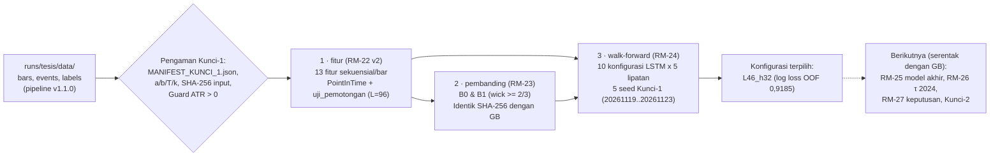

# Pemodelan LSTM: 13 Fitur Sekuensial 3D (v2), Baseline B0/B1, dan Validasi Walk-Forward

Dokumen ini menjelaskan tiga tahap pertama pemodelan **LSTM (*Long Short-Term Memory*)** di `src/model/lstm/`, yang dirancang sejajar (*apple-to-apple*) dengan pemodelan Gradient Boosting (`src/model/gradient_boosting/`):

1. **Tahap 1 (`fitur` · RM-22 v2):** rekayasa **13 fitur sekuensial *point-in-time*** per candle (diturunkan dari Proposal Tabel 4.5, Kuesioner RQ1, dan *selected-papers*) + `uji_pemotongan`;
2. **Tahap 2 (`pembanding` · RM-23):** baseline non-model B0 dan B1 (*wick* ≥ 2/3) — **identik bit demi bit dengan Gradient Boosting**;
3. **Tahap 3 (`walk-forward` · RM-24):** validasi *walk-forward* 10 konfigurasi LSTM (5 seed Kunci-1) untuk memilih konfigurasi terbaik berdasarkan rata-rata *log loss* OOF 2019–2023.

> **Status (25 Nov 2026).** Kode v2 (13 fitur *theory-driven*), unit test (256 tes), dan eksekusi pada data asli pipeline **v1.1.0** sudah selesai. Tahap lanjutan (model akhir RM-25, kalibrasi *temperature scaling* τ 2024 RM-26, aturan keputusan RM-27, dan Kunci-2) sengaja belum dijalankan — persis mengikuti status repo Gradient Boosting saat ini agar kedua jalur bergerak serentak.

---

## 1. Gambaran Besar untuk Pemula: Bagaimana Proyek Ini Bekerja?

Penelitian tesis ini memprediksi apa yang terjadi setelah harga XAUUSD H1 **menyentuh level PDH (*Previous-Day High*) atau PDL (*Previous-Day Low*) untuk pertama kalinya dalam satu sesi** (*first touch*):

- **`Reversal`:** harga berbalik arah dan mencapai target profit `+2 × ATR` sebelum tersentuh batas rugi `−1 × ATR` dalam 8 jam ke depan.
- **`Continuation`:** harga justru menerobos level dan menyentuh `−1 × ATR` (arah berlawanan dari *reversal*).
- **`Netral`:** setelah 8 candle H1 (`T = 8`), kedua batas tidak ada yang tersentuh.

Proyek dibagi menjadi dua lapisan besar:

1. **Lapisan Data (`src/pdhl_data/`, v1.1.0):** mengolah 100.000 bar mentah XAUUSD H1 menjadi data bersih `runs/tesis/data/` (`dev` 2016–2023 = 1.841 event, `calib` 2024 = 227 event) dan menyegel data uji `runs/tesis/kunci_uji/` (Jan 2025 – Jul 2026 = 341 event) dengan status hanya-baca dan SHA-256.
2. **Lapisan Pemodelan (`src/model/`):** dua subpaket independen membaca data `runs/tesis/data/` yang **100% sama**:
   - `src/model/gradient_boosting/` → LightGBM (melihat **15 fitur ringkasan tabular** pada satu titik waktu `t*`).
   - `src/model/lstm/` → LSTM PyTorch (melihat **rekaman berurutan sepanjang `L` candle terakhir** dengan **13 fitur per candle**).

---

## 2. Perbandingan Alur: Gradient Boosting vs LSTM



| Aspek | Gradient Boosting (`src/model/gradient_boosting/`) | LSTM (`src/model/lstm/`) |
| :--- | :--- | :--- |
| **Data masukan** | `runs/tesis/data/` (v1.1.0, diverifikasi SHA-256) | **100% sama** |
| **Kunci-1 & Guard** | `MANIFEST_KUNCI_1.json`, `AtrKosong`, `TestDataLeak`, `PointInTime` | **100% sama** |
| **Bentuk fitur (RM-22)** | Tabel 2D `(N, 15)` — ringkasan 1 titik waktu `t*` | Tensor 3D `(N, L, 13)` — urutan `L` candle sampai `t*` |
| **Baseline (RM-23)** | B0 & B1 (*wick* ≥ 2/3, Laplace +1) | **100% identik** (`pembanding_oof_dev.csv` SHA-256 sama persis: `295010275517ebb1…`) |
| **Lipatan & Purging (RM-24)** | Expanding 2019–2023 (`N = 1.152`), purge `label_end_session_date >= 1 Jan y` | **100% sama** |
| **Grid & Seed** | 8 konfigurasi LightGBM, `seed = 20261119` | 10 konfigurasi LSTM (`L × hidden`), 5 seed `20261119..20261123` |
| **Kriteria pilih** | Log loss OOF terkecil (`toleransi_seri = 1e-6`) | **100% sama** |
| **Kalibrasi OOF** | Tidak dikalibrasi (kalibrasi khusus 2024) | **100% sama** |
| **Folder keluaran** | `runs/tesis/model/gradient_boosting/{data,output}/` | `runs/tesis/model/lstm/{data,output}/` |

---

## 3. Tahap 1: 13 Fitur Sekuensial Per-Candle v2 (*Theory-Driven*, RM-22)

Ke-13 fitur ini ditetapkan secara teoretis dari **3 sumber gabungan** (tanpa seleksi otomatis, sesuai Proposal IV.II.5):
1. **Proposal Final v2 (IV.II.5, Tabel 4.5):** jarak level, struktur candle, EMA50, rezim volatilitas ATR120, volume relatif jam-sama, sesi, dan hari.
2. **Kuesioner RQ1 (9 responden lolos `≥ 3 bulan`):** *wick* penolakan (`5/9`, #1), *close* dalam range / *breakout* (`3/9 + 3/9`), *engulfing* / *break body* (`3/9`), lonjakan volume (`3/9`), sesi London/NY (median `4`), **arah tren H1 (median `5` — tertinggi!)**, dan **kondisi volatilitas ATR (median `4`)**.
3. **Selected Papers:** Grądzki et al. (2025) (`EMA50`, `sin/cos` jam & hari), Jankowski & Weichbroth (2026) (*MA-spread* & *realized volatility*), Enkhbayar & Ślepaczuk (2025) (`EMA50` & `ATR14`), Moser & Brauneis (2026) (*real body* & *shadow* H1), dan Sokolovsky et al. (2023) (stasioneritas & volume *microstructure*).

Seluruh jarak harga dikalikan faktor arah `d` (`+1` untuk PDH, `−1` untuk PDL) dan dibagi `ATR_t*` (`atr14_h1` pada bar keputusan `t*`):

| Kode | Nama Fitur | Arti Singkatan | Rumus (tiap bar `i` di `[t* − L + 1 .. t*]`) | Untuk Apa & Sumber Utama |
| :-: | :--- | :--- | :--- | :--- |
| `s01` | `dist_level_dir` | *distance to level, directional* | `d · (close_i − level) / ATR_t*` | Mengukur seberapa dekat/menembus harga ke garis PDH/PDL (Proposal `f09`; Kuesioner K1 & K4; Sokolovsky 2023) |
| `s02` | `body_dir` | *candle body, directional* | `d · (close_i − open_i) / ATR_t*` | Mengukur kekuatan & arah badan candle — pola berurutan membentuk *engulfing* (Proposal `f14`; Kuesioner K3 & *"break body"*; Moser 2026) |
| `s03` | `range_atr` | *candle range per ATR* | `(high_i − low_i) / ATR_t*` | Mengukur lebar total gejolak 1 candle dibanding ukuran normal ATR (Moser 2026) |
| `s04` | `wick_against_dir` | *wick against direction* | Sumbu penolakan searah *reversal* `/ ATR_t*` | Mengukur kekuatan penolakan/pantulan dari level (Proposal `f13` & `f10`; Kuesioner K2 **5/9, #1**; Moser 2026) |
| `s05` | `wick_with_dir` | *wick with direction* | Sumbu dorongan searah *continuation* `/ ATR_t*` | Pasangan simetris sumbu dorongan menuju/menembus level (Moser 2026) |
| `s06` | `dist_ema50_dir` | *distance to EMA(50), directional* | `d · (close_i − EMA50_i) / ATR_t*` | Membawa konteks **arah tren H1** jangka menengah melampaui jendela `L` (Proposal `f11`; Kuesioner 3.6 **median 5**; Grądzki/Jankowski/Enkhbayar) |
| `s07` | `vol_regime` | *volatility regime* | `ATR_i / mean(ATR_{i−119..i})` | Menandai apakah pasar sedang lebih volatil atau tenang vs 5 hari terakhir / 120 bar (Proposal `f06`; Kuesioner 3.7 **median 4**; Jankowski/Enkhbayar) |
| `s08` | `log_vol_rel_hour` | *log relative volume (same NY hour)* | `ln(V_i / mean V jam NY sama 20 sesi lalu)` | Mendeteksi lonjakan volume sejati tanpa bias sesi Asia sepi vs NY ramai (Proposal `f15`; Kuesioner K7 **3/9**; Sokolovsky 2023) |
| `s09` | `ny_hour_sin` | *New York hour, sine* | `sin(2π · ny_hour_i / 24)` | Jam perdagangan NY dalam bentuk siklik (agar 23:00 dekat 00:00) — menangkap sesi Asia/London/NY (Proposal `f04/f08`; Kuesioner K9 & 3.5 **median 4**; Grądzki 2025) |
| `s10` | `ny_hour_cos` | *New York hour, cosine* | `cos(2π · ny_hour_i / 24)` | Pasangan kosinus `ny_hour_sin` agar 24 jam terpetakan unik pada lingkaran `[-1, 1]` |
| `s11` | `weekday_sin` | *trading weekday, sine* | `sin(2π · weekday_i / 5)` (`0=Sen..4=Jum`) | Menandai hari perdagangan Senin–Jumat secara siklik (Proposal `f05`; Grądzki et al. 2025) |
| `s12` | `weekday_cos` | *trading weekday, cosine* | `cos(2π · weekday_i / 5)` | Pasangan kosinus `weekday_sin` pada `[-1, 1]` |
| `s13` | `log_gap_h` | *log gap in hours* | `ln(1 + hours_since_prev_i)` | Menandai jeda antarbar (jeda harian 2 jam pukul 17:00 NY atau buka akhir pekan > 48 jam) |

**Bukti kualitas & *point-in-time* (0% bocor masa depan):**
- **Redundansi turun drastis:** membuang `ret_dir` (yang sebelumnya berkorelasi `r = 0,99` dengan `body_dir`), sehingga kini hanya 1 pasangan fitur ber-`|r| ≥ 0,7` (`dist_level_dir × body_dir = 0,80`).
- **Bias jam pada volume hilang:** korelasi `log_vol_rel_hour` terhadap `ny_hour_sin` turun dari `−0,47` (v1) menjadi hanya `−0,03` (v2).
- **Guard `PointInTime` + Uji pemotongan (`L = 96`):** data dipotong pada 4 titik waktu (2018-02-28, 2020-06-17, 2023-10-31, 2024-12-31), seluruh konteks (`EMA50`, `ATR120`, peta volume 20 sesi) dan tensor 3D `(L × 13)` dihitung ulang dari nol — hasilnya **0 mismatch** di semua 4 titik (`498`, `1.019`, `1.812`, dan `2.068` event).

---

## 4. Tahap 2: Baseline Non-Model B0 dan B1 (RM-23)

Tahap ini memakai aturan, *purging*, dan rumus *log loss* yang identik 100% dengan jalur Gradient Boosting:
- **B0 (peluang dasar):** proporsi kelas historis pada data latih.
- **B1 (heuristik *wick*):** proporsi kelas dipisah berdasarkan aturan `f13_wick_penolakan ≥ 2/3` (`173` event dev terpenuhi, `1.668` tidak terpenuhi), dengan koreksi Laplace `+1` bila sebuah sel kosong.

Hasil OOF 2019–2023 (`n = 1.152`): **`B0 = 0,9698`**, **`B1 = 0,9678`** (`pembanding_oof_dev.csv` memiliki SHA-256 `295010275517ebb1…` — **identik bit demi bit** dengan milik Gradient Boosting).

---

## 5. Tahap 3: Arsitektur LSTM & Validasi Walk-Forward (RM-24)

### Arsitektur & Pencegahan *Overfitting*
- **Model:** 1-layer LSTM (`input_size = 13`, `hidden_size ∈ {16, 32}`) → ambil *hidden state* bar terakhir `h_T` → `Dropout(0,3)` → `Linear(hidden_size, 3)` → `logits` `[Reversal, Continuation, Netral]`.
- **Scaling Anti-Bocor (`SequenceScaler3D`):** standardisasi z-score hanya di-`fit` pada bagian latih di dalam tiap lipatan, **melewati 4 fitur siklik** (`s09..s12`: `ny_hour_sin/cos`, `weekday_sin/cos` yang sudah di `[-1, 1]`), dan memotong *outlier* di `[-10, +10]`.
- **Rem *Early Stopping* (`85% / 15%`):** 85% awal data latih dipakai memperbarui bobot (`AdamW`, `lr = 1e-3`, `weight_decay = 1e-2`, `grad_clip = 1,0`, `batch_size = 64`), sedangkan **15% ujung kronologis data latih** dipakai memantau *log loss* tiap *epoch* (`max_epochs = 80`, `patience = 12`). Bobot dikembalikan ke *epoch* terbaik — tahun validasi **tidak pernah disentuh**.
- **5 Seed Stabilitas:** 5 seed turunan Kunci-1 `[20261119, 20261120, 20261121, 20261122, 20261123]`, *logits* dirata-rata sebelum `softmax` (`num_threads = 1`, deterministik).
- **Grid 10 Konfigurasi:** 5 jendela `lookback_L ∈ {23, 40, 46, 60, 96}` (1 sesi = 23 bar, 2 sesi = 46 bar, serta `40, 60, 96` dari literatur) × 2 ukuran memori `hidden_size ∈ {16, 32}`.

---

## 6. Cara Menjalankan

```bash
pip install -e '.[lstm]'
PYTHONPATH=src python3 -m model.lstm semua --config configs/tesis.json --device cpu
PYTHONPATH=src python3 -m unittest discover -s tests -v
```

---

## 7. Hasil Eksperimen Riil v2 (13 Fitur, Data v1.1.0, 25 Nov 2026)

Lingkungan: Python `3.13.7`, PyTorch `2.15.0`, NumPy `2.5.5`, CPU deterministik (`num_threads = 1`).

### 7.1 Peringkat 10 Konfigurasi Walk-Forward (`dev` OOF 2019–2023, `n = 1.152`)

| Peringkat | Konfigurasi | `L` | `hidden` | 2019 | 2020 | 2021 | 2022 | 2023 | **OOF Log Loss** | Brier | ECE | Avg Epoch |
| :---: | :--- | :---: | :---: | :---: | :---: | :---: | :---: | :---: | :---: | :---: | :---: | :---: |
| **1** | **`L46_h32`** | **46** | **32** | 0,9153 | 0,9702 | 0,9081 | 0,9017 | 0,8980 | **0,9185** | **0,5508** | 0,0370 | 14,6 |
| 2 | `L40_h32` | 40 | 32 | 0,9153 | 0,9701 | 0,9081 | 0,9016 | 0,8987 | 0,9186 | 0,5509 | 0,0373 | 14,5 |
| 3 | `L60_h32` | 60 | 32 | 0,9167 | 0,9704 | 0,9082 | 0,9018 | 0,8985 | 0,9189 | 0,5511 | 0,0327 | 15,4 |
| 4 | `L96_h32` | 96 | 32 | 0,9170 | 0,9703 | 0,9114 | 0,9020 | 0,8970 | 0,9194 | 0,5513 | 0,0313 | 15,8 |
| 5 | `L23_h32` | 23 | 32 | 0,9156 | 0,9698 | 0,9091 | 0,9050 | 0,9034 | 0,9204 | 0,5519 | 0,0306 | 13,3 |
| 6 | `L96_h16` | 96 | 16 | 0,9211 | 0,9742 | 0,9110 | 0,8989 | 0,9023 | 0,9213 | 0,5519 | 0,0318 | 24,6 |
| 7 | `L46_h16` | 46 | 16 | 0,9224 | 0,9741 | 0,9101 | 0,9009 | 0,9010 | 0,9215 | 0,5521 | 0,0363 | 25,2 |
| 8 | `L40_h16` | 40 | 16 | 0,9225 | 0,9740 | 0,9101 | 0,9035 | 0,9008 | 0,9220 | 0,5524 | 0,0345 | 24,6 |
| 9 | `L60_h16` | 60 | 16 | 0,9221 | 0,9742 | 0,9109 | 0,9007 | 0,9046 | 0,9223 | 0,5524 | 0,0361 | 23,4 |
| 10 | `L23_h16` | 23 | 16 | 0,9229 | 0,9735 | 0,9101 | 0,9072 | 0,9025 | 0,9230 | 0,5531 | 0,0362 | 23,3 |

- **Konfigurasi terpilih:** **`L46_h32`** (tanpa seri dalam toleransi `1e-6`; terdekat `L40_h32` berselisih `+0,0001`).
- **Makna domain `L = 46`:** tepat **2 sesi perdagangan XAUUSD penuh** (`2 × 23 bar`), sehingga LSTM membaca utuh sesi kemarin (yang membentuk PDH/PDL) ditambah perjalanan sesi hari ini sampai menyentuh level.
- **Lompatan dari 10 fitur (v1) → 13 fitur (v2):** OOF Log-Loss terbaik turun signifikan dari **`0,9271` → `0,9185`** (`−0,0086`), dan **seluruh 10 konfigurasi LSTM v2 (`0,9185–0,9230`) kini melampaui acuan LightGBM terbaik (`0,9233`)**.

### 7.2 Kestabilan Per Tahun & Perbandingan Deskriptif vs B0, B1, dan LightGBM

*(Perbandingan OOF bersifat deskriptif, bukan uji hipotesis resmi — uji resmi baru dilakukan pada data uji saat Kunci-2.)*

| Tahun | n latih | n val | B0 | B1 (*wick*) | LightGBM (`d2_n100_m50`) | **LSTM v2 (`L46_h32`)** | LSTM − B0 | LSTM − B1 |
| :---: | :---: | :---: | :---: | :---: | :---: | :---: | :---: | :---: |
| **2019** | 689 | 227 | 0,9563 | 0,9563 | **0,9024** | 0,9153 | −0,0410 | −0,0410 |
| **2020** | 916 | 227 | 1,0035 | 1,0007 | **0,9636** | 0,9702 | −0,0333 | −0,0305 |
| **2021** | 1.143 | 236 | 0,9764 | 0,9712 | 0,9114 | **0,9081** | −0,0684 | −0,0631 |
| **2022** | 1.379 | 236 | 0,9452 | 0,9391 | 0,9165 | **0,9017** | −0,0434 | −0,0374 |
| **2023** | 1.615 | 226 | 0,9683 | 0,9726 | 0,9233 | **0,8980** | −0,0703 | −0,0746 |
| **Gabungan** | — | **1.152** | **0,9698** | **0,9678** | **0,9233** | **0,9185** | **−0,0513** | **−0,0493** |

**Temuan penting:**
1. **5 dari 5 tahun selalu unggul atas baseline:** selisih gabungan **`−0,0513`** terhadap B0 dan **`−0,0493`** terhadap B1.
2. **Keunggulan progresif saat data bertambah:** setelah konteks tren (`dist_ema50_dir`), rezim volatilitas (`vol_regime`), volume jam-sama (`log_vol_rel_hour`), dan hari siklik (`weekday_sin/cos`) ditambahkan, **LSTM mengungguli LightGBM di 3 tahun terakhir berturut-turut (2021, 2022, 2023) dan pada skor gabungan (`0,9185` vs `0,9233`)**.

---

## 8. Yang Belum di Repo (Tahap Lanjutan Serentak dengan Gradient Boosting)

Mengikuti Bagian 9 `docs/PEMODELAN_GRADIENT_BOOSTING.md`, keempat tahap berikut akan ditambahkan serentak untuk kedua model:
- **Model akhir (RM-25):** melatih `L46_h32` (5 seed) sekali pada seluruh `dev` (2016–2023) dan menyimpan bobot + scaler.
- **Kalibrasi *temperature scaling* τ pada data 2024 (RM-26):** mencari `τ ∈ [0,05; 20,0]` pada `calib` (227 event).
- **Aturan keputusan RM-27:** menghitung `m_rev` dari event Netral `dev` dan menerapkan ambang `δ = 0,1R`.
- **Kunci-2 & eksekusi tunggal pada `kunci_uji/`:** membuka 341 event uji sekali jalan untuk evaluasi final RQ2.1 (bootstrap klaster 2.000×) dan RQ2.2 (uji plasebo).
